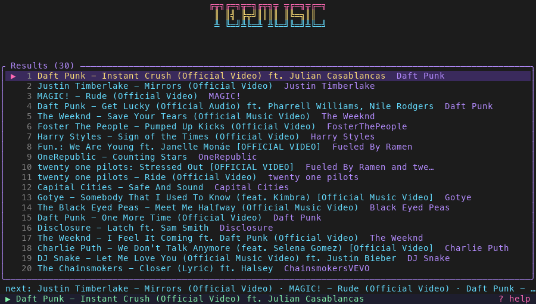
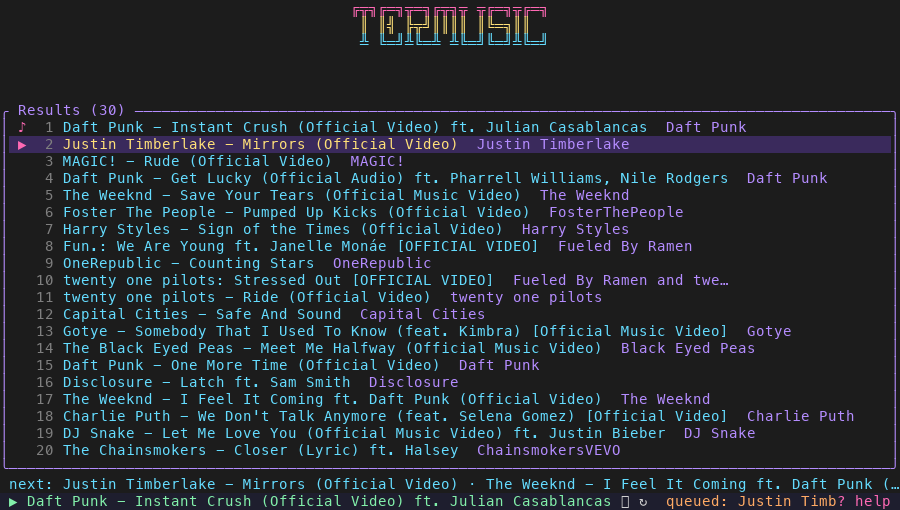
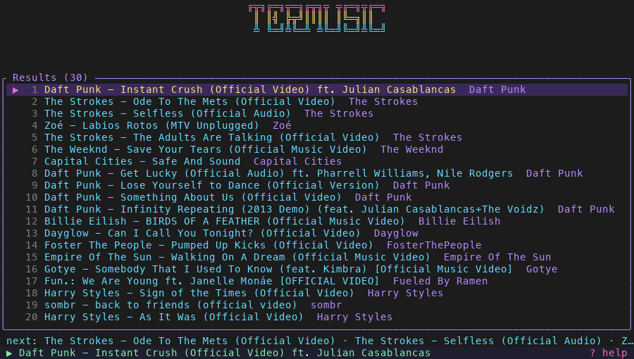
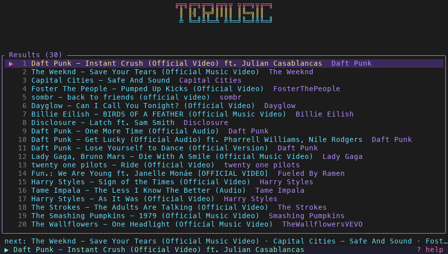
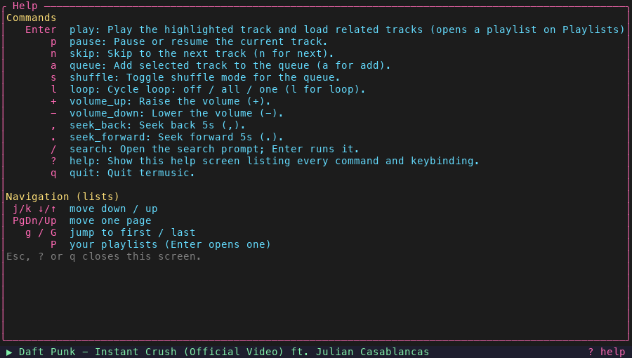
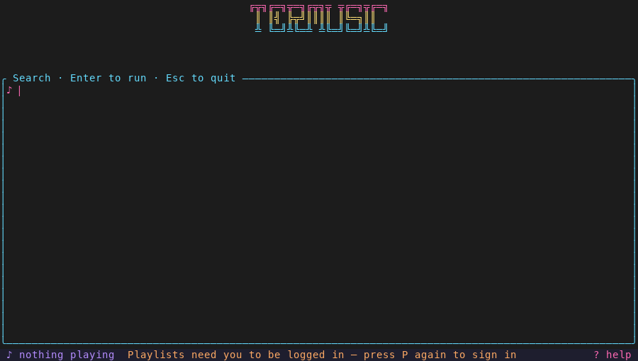

# termusic quickstart (branch `sprint-3-overnight`)

**Prerequisites:** macOS, `brew install mpv yt-dlp`, Rust toolchain. Google login is optional (needed only for playlists): export `TERMUSIC_CLIENT_ID` (and `TERMUSIC_CLIENT_SECRET` if your Desktop client has one) or keep `client_secret.json` in `~/Library/Application Support/termusic/`.

```sh
git checkout sprint-3-overnight && cargo run
cargo test && cargo clippy -- -D warnings      # 67 tests, clean
```

## Hand test script
1. **Search + play.** Type `daft punk`, Enter, then `j`/`k`, Enter on a track. Status bar shows `▶ title`. 
2. **Queue (item 3).** On results press `a` on two other tracks: status says `queued: ...` and a `next: A · B · C` line appears above the bar; the playing song is not interrupted. `n` plays the queued track first. 
3. **Shuffle / loop (items 2, 4).** `s` toggles ⤮ (shuffles only upcoming, never the current track). `l` cycles off → `↻` (all) → `↻1` (one: current track repeats; `n` still skips). 
4. **Seek and volume.** `.` jumps forward 5 s, `,` back 5 s, `+`/`-` volume. 
5. **Back (item 6).** `n` then `b` returns to the previous track. 
6. **Help.** `?` lists every command, must fit without scrolling in 80x24 (`Esc` closes). 
7. **Playlists logged out (item 5).** On Search press `F2` (or `P` on results): status says `Playlists need you to be logged in (P/F2: sign in)`; press again to reach the Login screen. 
8. **Playlists logged in.** Complete login in the browser (or `cargo run -- login`), press `P`, Enter on a playlist: it replaces the queue and starts playing; `n`/auto-advance follow playlist order. *Not tested by me.*
9. **No leftover mpv.** Press `q`, then `pgrep -fl "mpv --no-video"` prints nothing. Also try `kill -9` on the termusic pid: within ~2 s the watchdog removes mpv.
10. **Offline.** Turn Wi-Fi off, start the app: Offline screen, `r` retries.

Screenshots are regenerated with `scripts/capture.py` (needs `pip install pyte pillow`), e.g. `scripts/capture.py w:2 t:daft\ punk k:enter w:12 snap:demo k:q`.

## Known gaps / not verified
Real Google login, PKCE acceptance by Google, token refresh; media keys (spike notes in SPRINT.md; mpv may handle them itself, try it); playlist Enter-to-play against a real playlist; seek/loop-toggle on a real track by ear; shuffle-off does not restore order; loop-all wraps only from the started track on; stepped-back (`b`) tracks survive a new Enter; menu bar widget and cassette art (items 8, 9) not started.


## My thoughts
There are definitely some quirks with fixing 

For me, I need to fix the google authentication, firstly I need to give the project its own project, right now for some reason it is being tied to another project, and the other issue is that I need to add a few approved testers so that the account is able to login. 
Although I think the art is a cherry on top, I'll begin work on it today 

Certain errors and things to fix 
1. First of all it seems like the preloading isnt working properly, and songs are not being preloaded and crossfaded
2. For the UI elements, there should be more visual feedback such as having a song completion bar, along with a volume bar. (We will discuss the implementation of this)'
3. There is no easy way to go back to a song you were playing from pressng Esc, since you enter the search tab, and from there it isn't too clear how to get back it if it was an accidental press. 
4. The mac menu bar widget only connects the pause, the skip buttons do not work, so that needs to be investigated. 
5. There should be more verbose coverage of commands in the help menu, currently not all commands are properly represented. 
6. There isnt a settings menu yet, and if there is, there is no clear way to get to it. 
7. Test coverage overall looks pretty good, but I want every single function to get unit tests, along with more comprehensive unit tests for other items. 
8. It appears for every new song, the volume is defaulted to a preset rather than carrying across in relation to user settings. 
9. I think a nice addition would be to have a customizable history file, where it shows the last 10 links for the songs that you played. This allows a user to open up a song back and start where they were playing from. 